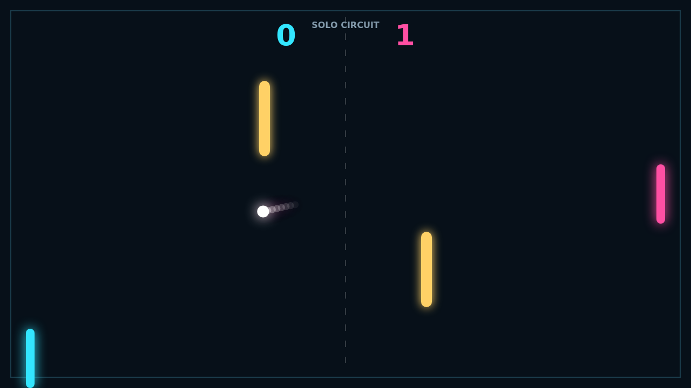

# Carom

Carom turns a familiar paddle duel into a compact game of angles. Every rally begins at center field, then quickly becomes a contest to claim space around two bright blockers.

Move through contact and the ball bends with your paddle. A flat return buys time; a hard rising stroke can curl into a wall, glance off an obstacle, and arrive from an angle your rival never prepared for.

In Solo, a quick computer defender forces you to construct those bank shots. Local Versus puts both paddles on one keyboard and makes every sudden reversal personal.

Matches run to eleven and must be won by two, so match point can stretch into a tense series of faster, sharper rallies.

